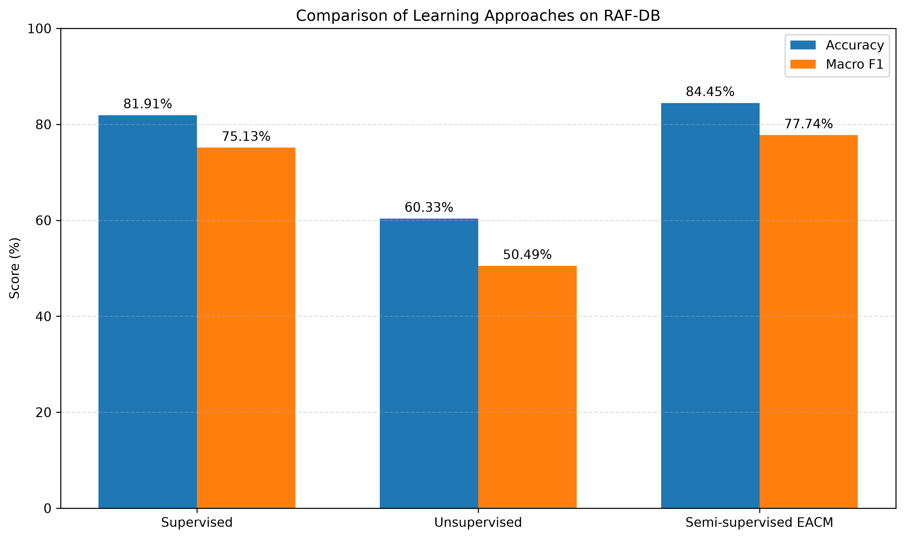
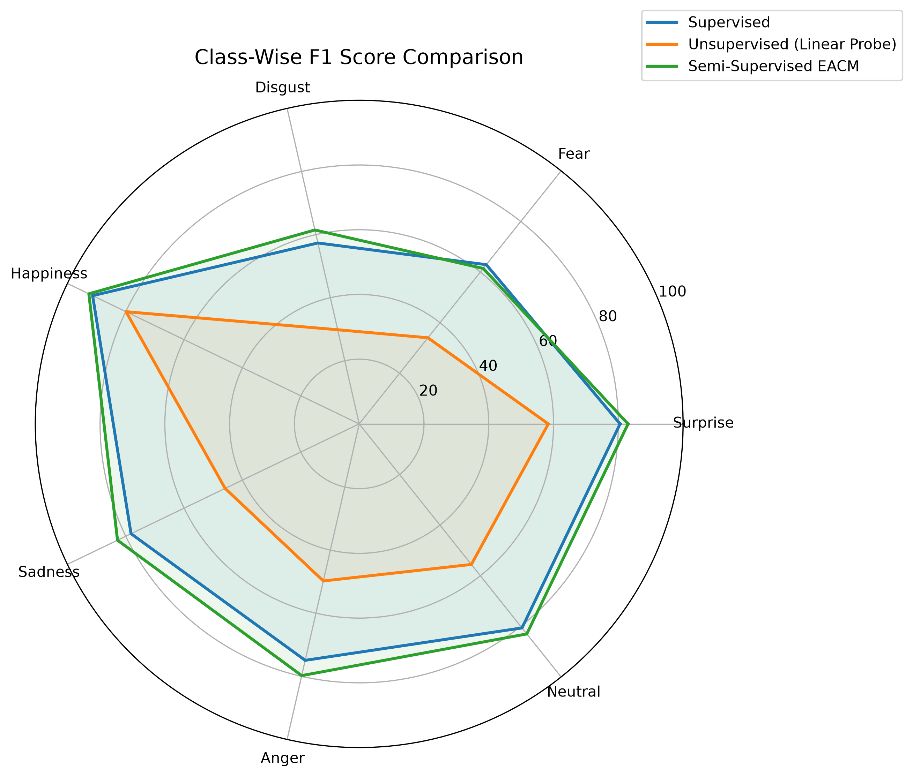
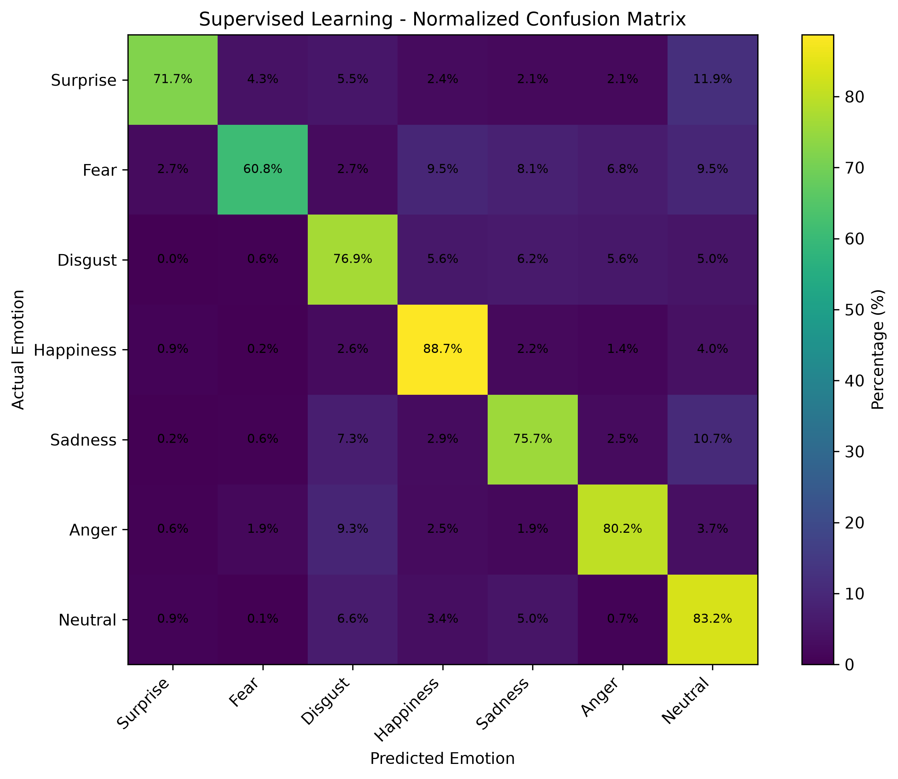
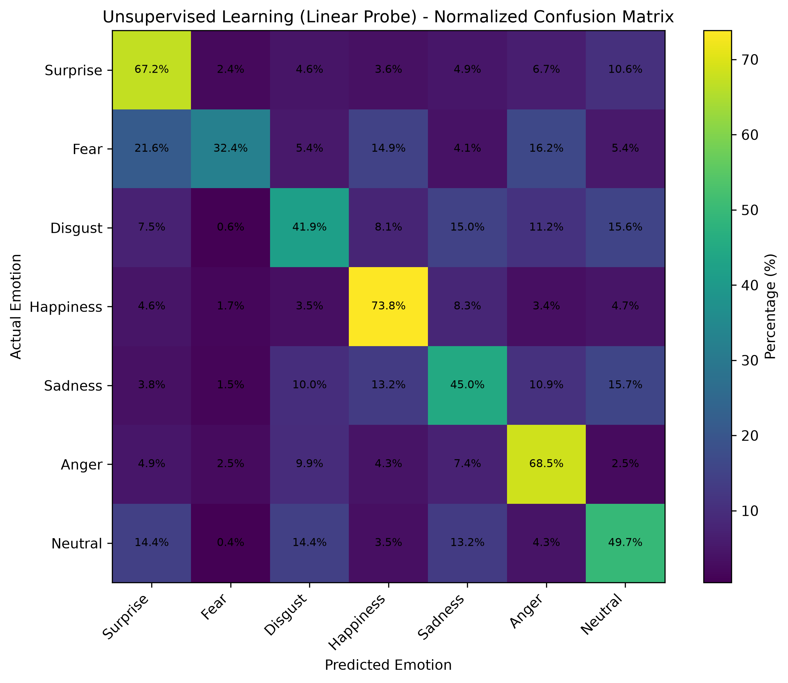
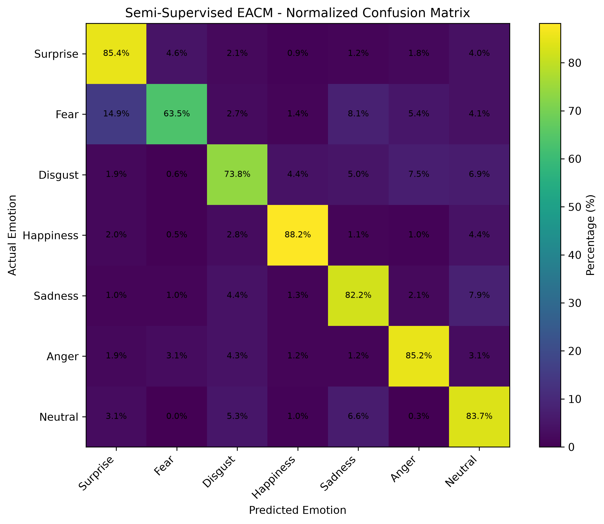
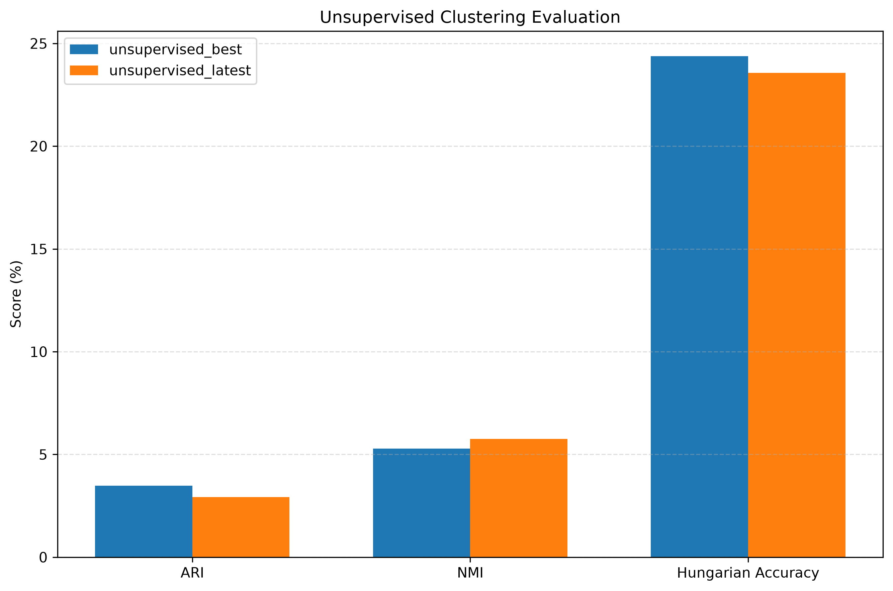

# Ada-CM

This is the official PyTorch implementation of our CVPR 2022 paper:

> [**Towards Semi-Supervised Deep Facial Expression Recognition with An Adaptive Confidence Margin**](https://openaccess.thecvf.com/content/CVPR2022/html/Li_Towards_Semi-Supervised_Deep_Facial_Expression_Recognition_With_an_Adaptive_Confidence_CVPR_2022_paper.html)      
> Hangyu Li, Nannan Wang*, Xi Yang, Xiaoyu Wang, Xinbo Gao        
> *In Proceedings of the IEEE/CVF Conference on Computer Vision and Pattern Recognition (CVPR), 2022*

## Update
- **(2022/04/28)** We upload the main files for training on RAF-DB.
- **(2022/05/10)** We provide the pre-trained [ResNet-18](https://drive.google.com/file/d/17Jbg3G31uLTlwoB3thHlGrXD7BCH9CJZ/view?usp=sharing) on MS-Celeb-1M. Please put it into ***./models***.

## Requirements

We test the codes in the following environments:

- Python==3.6.9
- PyTorch==1.3.0
- Torchvision==0.4.1

## Dataset setup

Please download the dataset from [RAF-DB](http://www.whdeng.cn/raf/model1.html) website and change the root to your path. The splits of different-class labeled data are listed below. For example, for the case of 100 labels, the labeled training set consists of 10 faces annotated with fear and 15 faces annotated with other expressions. More details could be found in the supplementary material, which is available at CVF website. 

<table align="center">
    <tr>
        <th> </th>
        <th align="center" colspan=1>100 labels</th>
        <th align="center" colspan=1>400 labels</th>
        <th align="center" colspan=1>1000 labels</th>
        <th align="center" colspan=1>2000 labels</th>
        <th align="center" colspan=1>4000 labels</th>
    </tr>
    <tr>
        <td align="left">Fear</td>
        <td align="center">10</td>
        <td align="center">40</td>
        <td align="center">100</td>
        <td align="center">200</td>
        <td align="center">250</td>
    </tr>
    <tr>
        <td align="left">Others</td>
        <td align="center">15</td>
        <td align="center">60</td>
        <td align="center">150</td>
        <td align="center">300</td>
        <td align="center">625</td>
    </tr>
</table>

## Getting Started

To train on RAF-DB:

```bash
python main.py
```

## Citation

If you find our work useful in your research, please consider citing:

    @inproceedings{li2022adacm,
      title={Towards Semi-Supervised Deep Facial Expression Recognition with An Adaptive Confidence Margin},
      author={Li, Hangyu and Wang, Nannan and Yang, Xi and Wang, Xiaoyu and Gao, Xinbo},
      booktitle={Proceedings of the IEEE/CVF Conference on Computer Vision and Pattern Recognition (CVPR)},
      month={June},
      year={2022},
      pages={4166-4175}
    }

## Note

If you have any questions, please contact me.  Email:  hangyuli.xidian@gmail.com


---

# Research Extension: Comparative Study of Learning Paradigms

This repository extends the original Ada-CM implementation with additional experiments comparing supervised, unsupervised, and semi-supervised approaches for Facial Emotion Recognition (FER) using RAF-DB.

The extension investigates how different learning paradigms utilize labeled and unlabeled facial images and compares their resulting classification performance and learned representations.

**Note:** The original Ada-CM implementation and research paper are credited to their respective authors. The following experiments and comparative evaluation constitute an extension of that work.

## Learning Approaches

### 1. Supervised Learning

- ResNet-18 backbone initialized using pretrained MS-Celeb-1M weights.
- Trained using 4,000 labeled RAF-DB training samples.
- Cross-entropy loss for emotion classification.
- End-to-end model fine-tuning.

### 2. Unsupervised Learning

- Contrastive representation learning using two augmented views of each image.
- Uses all 12,271 RAF-DB training images without accessing emotion labels during representation learning.
- Evaluated using K-Means clustering and a frozen-backbone linear probe.

### 3. Semi-Supervised Learning (EACM)

- Uses 4,000 labeled and 8,271 unlabeled training samples.
- Adaptive class-specific confidence thresholds for pseudo-label selection.
- Combines supervised classification, pseudo-label-based learning, and contrastive feature learning.

## Dataset and Experimental Setup

| Parameter | Value |
|---|---:|
| Training images | 12,271 |
| Test images | 3,068 |
| Emotion classes | 7 |
| Labeled training samples | 4,000 |
| Unlabeled training samples | 8,271 |
| Random seed | 2 |
| Training epochs | 20 |

The same saved labeled subset is used for supervised and semi-supervised experiments.

The seven emotion categories are Surprise, Fear, Disgust, Happiness, Sadness, Anger, and Neutral.

## Comparative Results

| Learning Approach | Accuracy | Macro F1 |
|---|---:|---:|
| Supervised | 81.91% | 75.13% |
| Unsupervised (Linear Probe) | 60.33% | 50.49% |
| Semi-Supervised (EACM) | **84.45%** | **77.74%** |

EACM achieved an improvement of 2.54 percentage points in accuracy and 2.61 percentage points in macro F1 compared with the supervised baseline.

**Evaluation note:** The unsupervised result is obtained through a frozen-backbone linear probe, whereas the supervised and semi-supervised models are fine-tuned end-to-end. Therefore, the three results do not represent identical evaluation protocols.

### Overall Performance



### Class-wise F1 Comparison



### Confusion Matrices

**Supervised**



**Unsupervised**



**Semi-Supervised (EACM)**



### Unsupervised Clustering Evaluation

The best unsupervised checkpoint achieved the following clustering results:

| Metric | Value |
|---|---:|
| Adjusted Rand Index | 0.0348 |
| Normalized Mutual Information | 0.0528 |
| Hungarian-matched Accuracy | 24.38% |



Clustering metrics measure agreement between discovered clusters and ground-truth categories; they should not be interpreted as conventional classifier accuracy.

## Additional Scripts

The research extension introduces the following scripts inside `Journal/`:

| Script | Purpose |
|---|---|
| `train_supervised.py` | Supervised baseline training |
| `train_unsupervised.py` | Contrastive representation learning |
| `train.py` | Semi-supervised EACM training |
| `save_raf_split.py` | Reproducible labeled/unlabeled split |
| `evaluate_raf.py` | RAF-DB classification evaluation |
| `evaluate_unsupervised.py` | Clustering evaluation |
| `evaluate_linear_probe.py` | Frozen-backbone linear probe |
| `compile_results.py` | Consolidation of experiment results |
| `generate_report_graphs.py` | Generation of comparison visualizations |

## Limitations

- RAF-DB contains imbalanced emotion classes, particularly Fear.
- Experiments use a single random seed.
- The supervised and EACM scripts select their best checkpoints using test-set accuracy, introducing test-set model-selection bias.
- The unsupervised linear-probe protocol differs from end-to-end fine-tuning.
- Results should therefore be interpreted as exploratory experimental findings.

## Reproducibility

The dataset and pretrained model checkpoints are not included in this repository. They must be obtained separately and configured before running the additional training scripts.

The research experiments use a saved RAF-DB split and random seed 2.

Please refer to the original Ada-CM documentation above for the original implementation's setup and citation.
